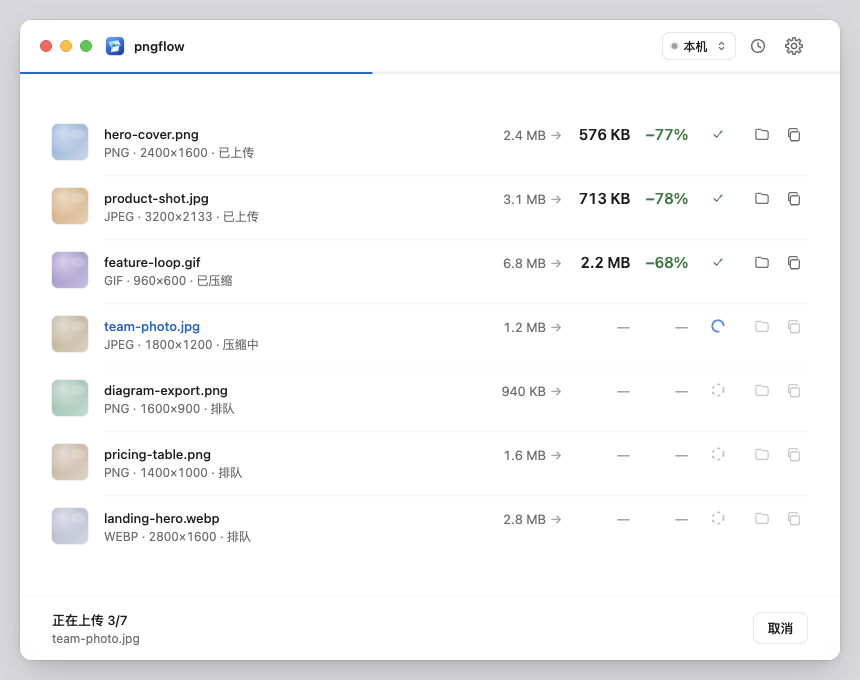
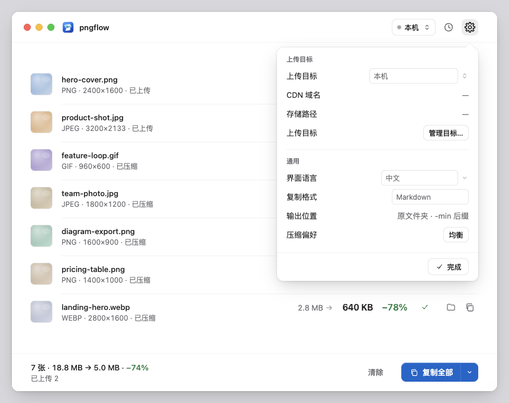
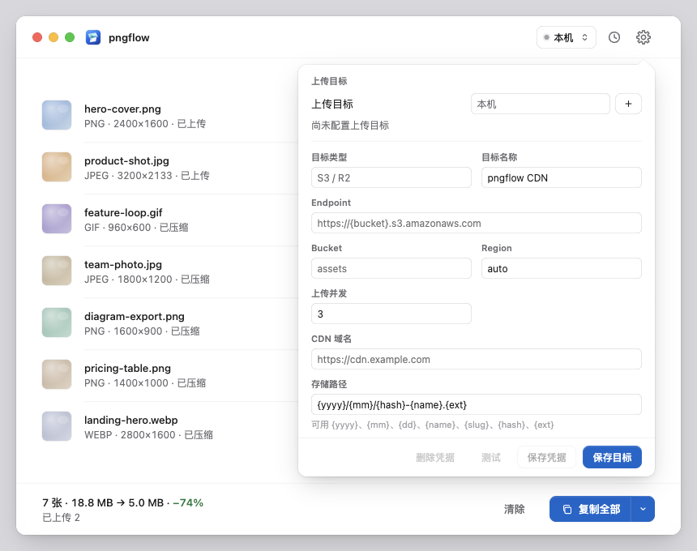
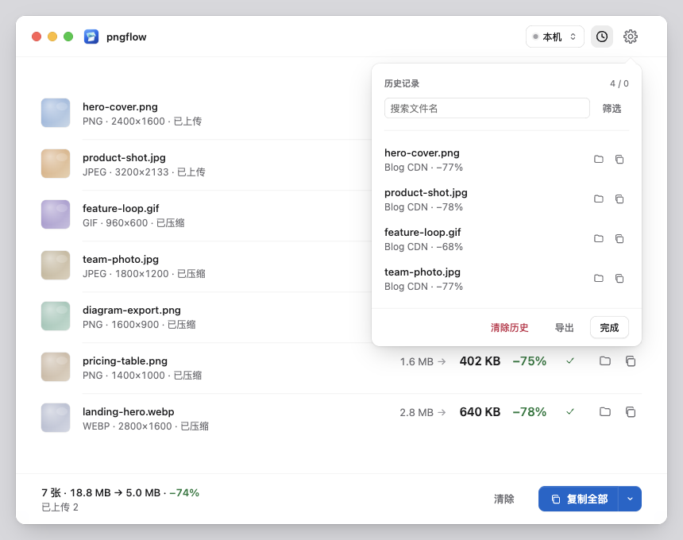
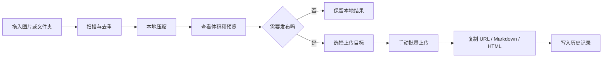
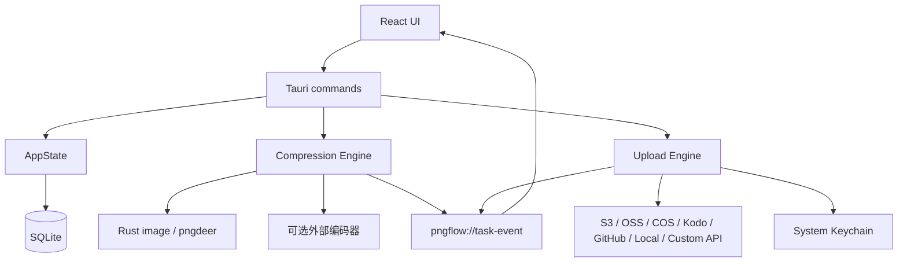

<p align="center">
  
</p>

<h1 align="center">pngflow</h1>

<p align="center">
  本地压缩，确认后上传，一键拿到可发布的图片链接。
</p>

<p align="center">
  Tauri · React · Rust · SQLite · 多图床
</p>

---

pngflow 是一个面向博客作者、设计师、开发者和内容团队的桌面图片工作台。把截图或素材拖进窗口，pipeline 会先在本地完成压缩；需要发布时，再手动选择图片上传到 CDN、对象存储或本地目录。

它解决的不是“再多提供一个压缩参数”，而是发布图片这件小事里反复出现的三处摩擦：压缩和上传混在一起、上传前看不到结果、拿到链接后又不知道它去了哪里。



## 为什么用它

### 先压缩，后决定是否上传

导入图片后自动开始本地压缩。源图不会因为打开 pngflow 就被上传，只有明确选择图片并点击上传，才会写入远端。

每一步都有可见结果：

1. 导入后看到文件数量和格式；
2. 压缩后看到原始体积、输出体积和节省比例；
3. 上传后看到目标、进度和可复制的公开链接；
4. 清理时可以只清空队列，也可以同时删除 pngflow 生成的压缩文件。

### 一次处理一组图片，而不是逐张重复操作

桌面端适合承接截图、文章配图和设计导出的批量处理。队列会把每一张图片的状态放在同一行：压缩进度、上传状态、体积变化、复制与定位操作都能直接看到。

支持 JPEG、PNG、GIF、WebP、SVG 和 AVIF。专业编码器可用时优先调用 `cjpeg`、`pngquant`、`oxipng`、`cwebp`、`avifenc` 等工具；JPEG/PNG 另有 Rust 内建编码兜底。

### 上传目标明确，不偷偷兜底

工具栏始终显示当前目标。`本机` 表示只保留压缩结果；选择 `Blog CDN` 后，上传按钮才具备远端语义。应用不会在目标为空时偷偷使用列表里的第一个图床。

### 链接只在真正可用后出现

复制按钮只在图片上传完成且已有公开链接时启用。链接格式支持 URL、Markdown、HTML 和自定义模板，适合直接粘贴到博客、文档或站点源码。

## 界面

| 设置 | 上传目标 |
| --- | --- |
|  |  |

| 历史记录 | 工作流 |
| --- | --- |
|  | pngflow 把发布前的最后一段路收进一个窗口：拖入、压缩、比较、选择、上传、复制，每一步都留下可检查的状态。 |

## 快速开始

### 环境

- Node.js 18+，建议使用当前 LTS
- pnpm
- Rust stable
- Tauri v2 对应的系统依赖

系统依赖以 [Tauri prerequisites](https://v2.tauri.app/start/prerequisites/) 为准。macOS 还需要在首次打开时允许本地文件访问。

### 运行桌面应用

```bash
cd apps/desktop
pnpm install
pnpm tauri dev
```

### 只运行浏览器预览

```bash
cd apps/desktop
pnpm dev
```

打开 `http://127.0.0.1:1420/` 可以查看界面和交互。浏览器模式使用 mock command 作为 fallback，不能代表真实压缩、上传或凭据读写。

用于 README 截图和视觉回归的状态可以直接打开：

```text
http://127.0.0.1:1420/?preview=idle
http://127.0.0.1:1420/?preview=working
http://127.0.0.1:1420/?preview=settings
http://127.0.0.1:1420/?preview=targets
http://127.0.0.1:1420/?preview=history
```

这些 fixture 只在没有 Tauri runtime 时启用，不会进入桌面应用。

### 可选编码器

macOS 可以使用 Homebrew 安装完整工具链：

```bash
brew install mozjpeg pngquant oxipng gifsicle webp libavif
npm install -g svgo
```

设置页会显示当前机器的编码器可用状态。缺少工具时，应用会明确提示；不要仅凭界面开启了某个输出格式，就假定对应编码器已经存在。

## 上传目标

| Provider | 适用场景 |
| --- | --- |
| S3 / Cloudflare R2 | 博客和静态站点的对象存储 |
| 阿里云 OSS | 国内静态资源与 CDN |
| 腾讯云 COS | 腾讯云对象存储 |
| 七牛云 Kodo | 七牛对象存储 |
| GitHub 仓库 | 小规模素材库和公开链接 |
| 本地目录 | 本地验证、静态站点构建目录 |
| Custom API | 已有自有上传接口的团队 |

目标配置包含 endpoint、bucket、region、公开域名、路径模板、缓存策略、复制的默认格式和并发数。路径模板支持：

```text
{yyyy}/{mm}/{dd}/{hash}-{name}.{ext}
```

上传前可以执行连通性测试。测试会在目标中写入 `__pngflow_route_test__/connection.txt`，成功后尝试删除，用于同时检查凭据、路径、权限和公开 URL。

## 安全边界

pngflow 不把 Access Key、Secret、Session Token 或 API Token 写进 SQLite。数据库中只保存类似 `keychain://pngflow/{routeId}` 的引用，真实凭据写入系统安全存储：

- macOS Keychain
- Windows Credential Manager
- Linux Secret Service

清理与删除也有边界：只有当路径符合 pngflow 生成的输出文件时，应用才会执行本地文件删除。历史记录导出可以隐藏本地 `source` / `output` 路径，便于分享记录而不暴露目录结构。

## 工作流



压缩和上传都是长任务。Rust 通过 `pngflow://task-event` 向 React UI 推送批次、图片和队列状态；前端不依赖轮询猜测进度。

## 技术架构



| 层 | 实现 | 责任 |
| --- | --- | --- |
| 桌面壳 | Tauri v2 | 窗口、文件选择、剪贴板、系统能力与打包 |
| UI | React + TypeScript + Vite | 队列、弹窗、状态和错误文案 |
| 后端 | Rust | 文件扫描、压缩、上传、SQLite 与凭据边界 |
| 本地数据 | SQLite + rusqlite | 设置、目标、批次和历史 |
| 凭据 | keyring | 系统钥匙串中的敏感信息 |
| 网络 | reqwest blocking + rustls | 对象存储和自定义 API |

### 核心目录

```text
apps/desktop/
├── src/
│   ├── app/                 # 入口、i18n、错误消息、截图 fixture
│   ├── components/          # Toolbar 与图标
│   ├── contracts/           # 前端模型、预设和 command 封装
│   └── features/
│       ├── batch/           # 队列、状态机、压缩与上传流程
│       ├── history/         # 历史记录
│       └── settings/        # 通用设置与上传目标
└── src-tauri/
    ├── migrations/          # SQLite schema
    ├── icons/               # 桌面图标
    └── src/
        ├── commands/        # Tauri command 入口
        ├── compression/     # 格式、尺寸与编码器编排
        ├── uploaders/       # Provider adapters
        └── storage/         # SQLite 持久化
```

### 状态与数据

批量队列用 `AssetState` 描述每张图片，压缩和上传分别保留 `pending / running / done / failed / cancelled` 状态。按钮是否可用由显式条件决定：

- 有输出文件且未上传时，才能上传；
- 上传完成且有公开 URL 时，才能复制链接；
- 有有效输出路径时，才能定位文件。

SQLite 保存设置、上传目标、批次摘要、图片记录和历史。清空操作使用软删除；真正删除本地文件前会再次验证文件名和路径边界。

## 开发与验证

前端类型检查与构建：

```bash
cd apps/desktop
pnpm build
```

完整桌面检查：

```bash
cd apps/desktop
pnpm check
```

根目录的核心行为测试：

```bash
node scripts/smoke-test.js
node --test tests/core.test.mjs
```

构建桌面安装包：

```bash
cd apps/desktop
pnpm desktop:build
```

Rust 测试覆盖上传参数、路径编码、压缩输出、SQLite 恢复、凭据引用和安全删除等核心边界。涉及真实对象存储和自定义 API 的链路仍需要在拥有对应凭据的环境中单独验证。

## 当前边界

- README 截图来自浏览器 preview fixture；真实压缩和上传必须在 Tauri 桌面运行时验证。
- 外部编码器没有随应用打包，缺失时只能使用内建能力或得到明确错误。
- Provider 的单元级参数测试不等于线上权限验证；首次使用某个目标时应运行连接测试。
- 应用当前以 macOS 小窗口体验为主要设计目标，其他平台的打包和交互仍需逐项验证。

## 路线图

- 压缩质量对比与更直接的失败重试；
- 上传目标模板导入/导出；
- 菜单栏入口、剪贴板图片和全局快捷键；
- CLI 上传与静态站点集成；
- 暗色模式和 Provider 插件化。

---

pngflow 的目标很简单：让图片在发布前变小、让链接在可用后出现、让每一步都说得清楚。
